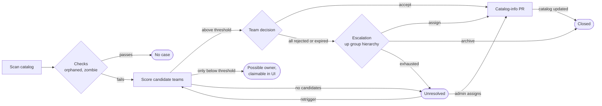

# ownership-matcher

Finds catalog entities whose owner is missing or no longer exists, proposes new owner teams, and escalates through the organization until someone takes ownership.

How it works:

1. A scheduled scan runs **checks** on catalog entities (`orphaned`: no owner or a placeholder owner; `zombie`: the owner is not an existing group).
2. For each failing entity, **proposal strategies** (commit history, catalog hierarchy, fallback) score candidate teams. Teams above a threshold are notified.
3. A team **accepts** or **rejects** the proposal in the UI. On acceptance, the plugin opens a pull request that updates `spec.owner` in `catalog-info.yaml`, then confirms the change reached the catalog.
4. If all proposals are rejected or expire, the case is **escalated** up the group hierarchy to people matched by job title, who can assign an owner or mark the entity for archiving. If they don't act in time, the next person takes over.



See [Statuses](plugins/ownership-matcher-backend/docs/statuses.md) and [Escalation](plugins/ownership-matcher-backend/docs/escalation.md) for details.

## Packages

| Package                                                                                                                                                     | Description                                       |
| ----------------------------------------------------------------------------------------------------------------------------------------------------------- | ------------------------------------------------- |
| [`@stepstone-tech/backstage-plugin-ownership-matcher`](plugins/ownership-matcher/README.md)                                                                 | Frontend plugin                                   |
| [`@stepstone-tech/backstage-plugin-ownership-matcher-backend`](plugins/ownership-matcher-backend/README.md)                                                 | Backend plugin: scans, proposals, escalation, PRs |
| [`@stepstone-tech/backstage-plugin-ownership-matcher-node`](plugins/ownership-matcher-node/README.md)                                                       | Extension points and contracts for modules        |
| [`@stepstone-tech/backstage-plugin-ownership-matcher-common`](plugins/ownership-matcher-common/README.md)                                                   | Notification origin and topic names               |
| [`@stepstone-tech/backstage-plugin-ownership-matcher-backend-module-bitbucket-server`](plugins/ownership-matcher-backend-module-bitbucket-server/README.md) | Bitbucket Server SCM provider                     |
| [`@stepstone-tech/backstage-plugin-ownership-matcher-backend-module-msgraph-email`](plugins/ownership-matcher-backend-module-msgraph-email/README.md)       | Email digest sender using Microsoft Graph         |

## Local development

From this directory:

```sh
yarn start
```

This starts Postgres in Docker (`docker-compose.yml`, `127.0.0.1:54321`) and the two dev packages:

- `packages/app` — frontend on http://localhost:3000, with the catalog, notifications, org and signals plugins
- `packages/backend` — backend on http://127.0.0.1:7007, with catalog, auth, permissions, events, notifications, signals and ownership-matcher

Configuration is in `app-config.yaml`, plus an optional gitignored `app-config.local.yaml`. You are signed in as a guest, permissions are allow-all, and the first scan runs 30 seconds after startup.

You land on a sign-in page — pick **Guest**. Without an identity every request goes out unauthenticated and the plugin reports "you are not an administrator" and "you are not a member of any groups" rather than a 401, so if you ever see those two messages together, check that you are actually signed in.

If `yarn start` fails with `Bind for 0.0.0.0:54321 failed: port is already allocated`, another project on the machine holds the database port — `docker compose ls -a` names it. The dev app also binds `127.0.0.1:7008`; if that is taken, the backend refuses to start and names the port.

### How the sample catalog is wired

The catalog is not read off disk. On startup the backend copies `examples/` into a temporary directory and serves it over HTTP on `127.0.0.1:7008` as a mock SCM server, and `app-config.yaml` declares an `integrations.*` entry for that host. Backstage only accepts its built-in integration types, so the mock borrows one (`MOCK_SCM_TYPE` in `packages/backend/src/scm/MockScmProvider.ts`) and serves its URL shape; nothing talks to a real server. Two things follow, and the plugin needs both:

- Every entity gets a `url:` `backstage.io/managed-by-location`. A `file:` location has no integration behind it, so `ScmRegistry` short-circuits before any provider is consulted — with one, entities route to a provider.
- A dev-only SCM provider (`packages/backend/src/scm/`) registers for that integration type. It supplies synthetic commit history, so `top-contributor` can score, and in-memory pull requests whose merge writes the new owner back into the served copy.

Each top-level directory under `examples/` is a mock repository, which is what lets a pull request rewrite one component's `catalog-info.yaml` without touching the others. The copy is recreated on every start, so a completed demo does not leave the catalog already fixed.

Nothing under `packages/` ships — both are `private` — and every plugin publishes `dist` only.

### What the sample data gives you

The signed-in guest is `user:default/guest`, a member of `team-example` and `team-data` — so the `?team=` selector has something to switch between — and of `dept-example` with a job title matching the escalation `titlePatterns`, which is what opens the lead-only views. `dave` leads the other department, so not every escalation in the catalog is yours.

After the first scan:

| View        | Shows                                                                                                             |
| ----------- | ----------------------------------------------------------------------------------------------------------------- |
| Dashboard   | three open cases and a confidence distribution spread over four buckets                                           |
| Entities    | the nine failing entities, across Component, API and Resource                                                     |
| Proposals   | six, three `pending` and three `possible_owner`, from 0.125 to 0.85                                               |
| Unresolved  | six rows: two Components, two APIs, two Resources, under both failing checks — the `kind` facet has three chips   |
| Scans       | the startup scan, plus any you trigger                                                                            |
| Pending     | `orphaned-service` on `team-example` and `etl-pipeline` on `team-data`                                            |
| My Teams    | the same two, seen as the department lead                                                                         |
| Escalations | empty until you reject `placeholder-owner-library` — that case escalates to `dept-example` and lands on the guest |
| History     | fills up as you accept and reject                                                                                 |

The scores are not arbitrary. With the default weights (`top-contributor` 0.5, `org-proximity` 0.3) and a system owner scoring 0.6, the commit fixtures in `packages/backend/src/scm/fixtures.ts` produce a team that both owns the system and wrote most of the code (0.725), a contested repo (0.5375 against 0.3125), a component with a system but no commits (0.225) and one with neither (nothing at all, so the case goes `unresolved`).

### Walking a case from accepted to closed

The deadline-checker sweep raises pull requests and reconciles their outcome. It runs every 15 minutes, which is fine in production and too slow to watch, so drive it by hand:

```sh
T=$(curl -s http://localhost:7007/api/auth/guest/refresh | jq -r .backstageIdentity.token)
sweep() { curl -s -X POST -H "Authorization: Bearer $T" \
  http://localhost:7007/api/ownership-matcher/.backstage/scheduler/v1/tasks/ownership-matcher-deadline-checker/trigger; }
```

Then, accepting `orphaned-service` in the UI:

1. the case goes `accepted`;
2. `sweep` — one pass raises the pull request against the mock host **and** merges it, writing the new owner into the served `catalog-info.yaml`;
3. the catalog re-reads that file within 30 seconds (`catalog.processingInterval`);
4. the next scan closes the case as `ownership_changed`.

The merge is immediate on purpose. `MERGE_AFTER_MS` in `packages/backend/src/index.ts` is `0` because a single sweep raises the PR and reconciles it in the same pass: a PR with any delay at all is still open at its only reconciliation, and `PR_RECONCILE_INTERVAL_MS` then puts the next check an hour out, stranding the case in `accepted`. Raise the constant if you want to see the open-PR state in the UI, and expect to wait out that hour.

`POST /api/ownership-matcher/scans/trigger` runs a scan without waiting for the daily schedule. The same scheduler endpoint drives proposal expiry: `ownershipMatcher.proposals.expirationMinutes` is 10, so a proposal left alone for ten minutes reaches `expired` on the next sweep.

Two statuses stay out of reach here. `to_archive` needs an escalation action and `cancelled` needs a proposal to be superseded; both depend on the escalation clock, whose `timeoutDays` has no minute-level override.

Outside production the `/leadership/*` endpoints accept `?asUser=<entityRef>`, which is the quickest way to check the lead-only views as somebody else — for example `user:default/alice`, who leads nothing.

The Bitbucket Server and Microsoft Graph modules need real credentials, so the dev backend doesn't install them. To try one, configure it in `app-config.local.yaml` and add it in `packages/backend/src/index.ts`.

## Integration tests

The backend integration tests use a real Postgres through testcontainers, so Docker is required:

```sh
yarn workspace @stepstone-tech/backstage-plugin-ownership-matcher-backend test:integration
```

With Rancher Desktop or Colima, export `DOCKER_HOST=$(docker context inspect --format '{{.Endpoints.docker.Host}}')` and `TESTCONTAINERS_DOCKER_SOCKET_OVERRIDE=/var/run/docker.sock` first.
